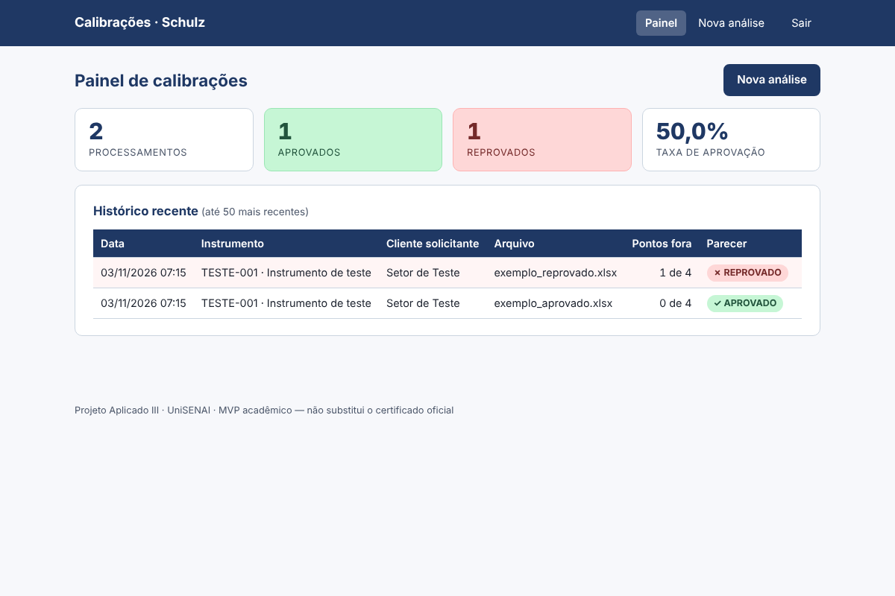

# MVP — Cálculo metrológico e parecer de calibração

Projeto Aplicado III · UniSENAI · Empresa parceira: Schulz S.A.
Entregas AV03 (MVP) e AV04 (plataforma em nuvem: histórico, login e deploy serverless na AWS).

Aplicação web simples que **recebe uma planilha Excel (.xlsx)** de calibração,
**calcula** média, erro sistemático e validação por ponto contra o limite de erro
admissível (LEA) e **apresenta o parecer final** (APROVADO / REPROVADO), com
opção de baixar um relatório em PDF.



## Como executar

```bash
python -m venv .venv
source .venv/bin/activate          # Windows: .venv\Scripts\activate
pip install -r requirements.txt
python app.py                      # abre em http://127.0.0.1:5000
```

Planilhas de teste (sintéticas) em `exemplos/`: `exemplo_aprovado.xlsx` e
`exemplo_reprovado.xlsx`. Para recriá-las: `python scripts/gerar_exemplos.py`.

## Rotas

| Método | Rota | Descrição |
|---|---|---|
| GET | `/` | painel: indicadores e histórico |
| GET | `/novo` | formulário de envio |
| POST | `/processar` | processa, grava o histórico e redireciona ao detalhe |
| GET | `/processamentos/<id>` | resultado e parecer de um processamento salvo |
| GET | `/pdf/<id>` | relatório em PDF |
| GET/POST | `/login`, POST `/logout` | acesso por senha (ativo só se `APP_PASSWORD` existir) |
| POST | `/api/processar` | mesma lógica, resposta em JSON |
| GET | `/health` | verificação de saúde (pública) |

A planilha enviada **não é guardada**: só o resultado calculado vai para o histórico
(memória no uso local, DynamoDB na nuvem). Limite de 4 MB, só `.xlsx`.

## Regras de negócio (`metrologia/calculos.py`)

| Etapa | Regra |
|---|---|
| Média das leituras | soma das leituras / quantidade, por ponto de ensaio |
| Erro sistemático | média − valor padrão (nominal) |
| LEA | \|Tol. +\| se o erro ≥ 0; \|Tol. −\| se o erro < 0 |
| Validação por ponto | \|erro\| ≤ LEA → `DENTRO_DA_TOLERANCIA`, senão `FORA_DA_TOLERANCIA` |
| Parecer final | `APROVADO` se todos os pontos estão dentro; senão `REPROVADO` |

Duas decisões de projeto, documentadas nos testes:

* **LEA por lado.** As tolerâncias da planilha podem ser assimétricas (ex.: +0,1 / 0,0).
  Com um único LEA, um erro negativo seria aceito indevidamente. Com tolerâncias
  simétricas o critério é idêntico a \|erro\| ≤ LEA.
* **Margem de 1e-7** contra imprecisão de ponto flutuante: `16,974 − 16,964` resulta em
  `0,010000000000001563` e não pode reprovar uma medida exatamente no limite.

## Ingestão (`metrologia/leitura.py`)

* `repair_xlsx_stream()` corrige planilhas salvas em **Strict Open XML** (as do Excel da
  Schulz), que o leitor padrão abre com zero abas. Trabalha em memória (`io.BytesIO`).
* O cabeçalho (`Parâmetro avaliado`, `Valor nominal`, `Tol. +`, `Tol. -`, `Medida N`) é
  localizado dinamicamente; texto acima/abaixo da tabela é ignorado.
* Metadados (cliente, técnico, código, data…) são buscados por palavra-chave.
* Linhas vazias, erros de fórmula (`#VALUE!`) e resíduos numéricos de rodapé são descartados.

## Estrutura

```
app.py                  interface web (Flask)
metrologia/leitura.py   ingestão e saneamento
metrologia/calculos.py  regras de negócio
metrologia/pdf.py       relatório em PDF (ReportLab)
metrologia/servico.py   orquestra leitura -> cálculo (independente do Flask)
templates/, static/     telas
tests/                  testes automatizados
scripts/, exemplos/     geração e planilhas de exemplo
```

## Testes

```bash
python -m pytest -v
```

37 testes cobrem cálculos, ingestão (incluindo o formato Strict), rotas, PDF e erros.
Há ainda 2 testes de regressão contra a planilha real da Schulz, que **não é versionada**;
para rodá-los localmente: `SCHULZ_XLSX=/caminho/planilha_real.xlsx python -m pytest`.

## Dados da empresa

As planilhas reais da Schulz trazem dados internos (nomes, códigos de instrumento) e
**não devem ser commitadas** — o `.gitignore` já exclui `.xlsm` e as pastas de dados
reais. Os exemplos e os testes usam apenas dados sintéticos.

## Limitações do MVP

* Sem persistência: o histórico fica em memória (últimos 50 processamentos).
* Não calcula a incerteza de medição (EA-4/02) e não emite o certificado oficial; o PDF
  é um relatório de apoio, sem timbre, numeração ou assinatura.
* Lê o layout da aba `Registro` do modelo da Schulz; a exportação bruta do Calypso (MMC)
  tem outra estrutura e não é lida.

## AV04 — Plataforma na nuvem (AWS serverless)

Arquitetura: **Lambda (Flask via apig-wsgi) + Function URL (HTTPS) + DynamoDB**, descrita em
`template.yaml` (AWS SAM). Sem servidor ligado 24 h: paga-se (ou usa-se a cota gratuita) só
quando há requisição.

### Pré-requisitos
Conta AWS, [AWS CLI](https://docs.aws.amazon.com/cli/latest/userguide/getting-started-install.html),
[SAM CLI](https://docs.aws.amazon.com/serverless-application-model/latest/developerguide/install-sam-cli.html)
e Python 3.12+. Configure o acesso com `aws configure` (usuário IAM, nunca a conta raiz).

### Deploy
```bash
python deploy/package.py            # monta build/package (deps para Linux x86_64)
sam deploy --guided                 # 1ª vez; responda aos parâmetros abaixo
```
Parâmetros: `SenhaApp` (≥ 12 caracteres), `ChaveSessao` (≥ 32 caracteres aleatórios, ex.
`python -c "import secrets;print(secrets.token_hex(32))"`), `EmailAlerta` (alerta de custo) e
`LimiteOrcamentoUsd`. Nas execuções seguintes: `python deploy/package.py && sam deploy`.
Ao final, o endereço aparece em `UrlDaPlataforma`.

### Verificação
```bash
python deploy/smoke_test.py https://<url-da-funcao> <senha>
```

### Remoção (zera qualquer custo)
```bash
sam delete --stack-name <nome-da-stack>
```

### Problemas comuns
* **403 Forbidden** na URL: faltam as permissões `lambda:InvokeFunctionUrl` **e**
  `lambda:InvokeFunction` (esta com `--invoked-via-function-url`). O `template.yaml` já as declara.
* **Função não sobe (500)**: veja o CloudWatch Logs; `ConfigError` indica senha/chave curtas ou ausentes.
* **Pacote muito grande**: `python deploy/package.py` informa o tamanho (limite de 250 MB).

### Testes
```bash
pip install -r requirements-dev.txt
python -m pytest -q                 # 91 testes (2 dependem de planilha real: SCHULZ_XLSX)
cfn-lint template.yaml
```

> Nunca versione planilhas reais da Schulz nem `samconfig.toml`/senhas (ver `.gitignore`).

## AV05 — Execução simples no Windows, QR Code e ROI

**Executar (Windows):** dê dois cliques em `iniciar_aplicacao_schulz.bat`. Ele confere o Python 3.10+,
cria/ativa a `.venv`, instala `requirements.txt`, inicia a API e abre o navegador em
`http://127.0.0.1:5000`. Para encerrar, feche a janela "Schulz API". Variáveis opcionais:
`PORT`, `HOST`, `PUBLIC_BASE_URL` (endereço que vai no QR Code).

**Validação por QR Code:** o PDF traz um QR para `/validar/<id>?t=<token>` (HMAC do id com a chave
da aplicação). A página é pública e mostra só parecer, instrumento e data. Trocar `SECRET_KEY`
invalida QR Codes já impressos.

**ROI:** `python scripts/calcular_roi.py` (opções `--custo-hora`, `--investimento`,
`--certificados-ano`, `--min-manual`, `--min-auto`). Custo da hora e investimento são premissas a confirmar.
